# Entregable 3 · Pruebas y validación

> Todas las tablas de este documento se generan con `experiments/` y se insertan con
> `python experiments/report.py` entre marcadores `<!-- tabla:… -->`. Ninguna cifra de una tabla
> se escribe a mano; en la prosa solo se citan cifras copiadas de esas tablas.
> `python experiments/report.py --check` falla si el documento quedó desactualizado.

## 1. Cómo reproducir

```bash
pip install -e ".[dev,exp]"
python experiments/run_experiments.py --bench               # mide y proyecta el tiempo (exp_meta/bench.csv)
python experiments/run_experiments.py --all --jobs 16       # campañas + representativas + tablas + figuras
python experiments/report.py                                # inserta las tablas en este documento
python experiments/run_experiments.py --all --verify        # re-ejecuta y compara sha256 de exp_runs/*.csv
pytest && pytest experiments                                # suite del repo + tests de los experimentos
```

Salidas (todas bajo `results/`, prefijo `exp_`):

| Carpeta | Contenido |
|---|---|
| `exp_runs/` | una fila por ejecución (`base.csv`, `reducido.csv`, `inviable.csv`, `footprint.csv`, `poblacion.csv`, `aleatoria.csv`), curvas agregadas por configuración y generación (`curvas_*.csv`), satélites finales de todas las ejecuciones (`finales_*.csv`) y la revalidación de P11 (`reval.csv`) |
| `exp_json/` | resultados completos representativos (cumplen `result.schema.json` y los valida `tests/test_contract.py`) |
| `exp_reval/` | `reval_base_repair_s42__<escenario>.json` de P11 (salida de `revalidate`, sin reoptimizar) |
| `exp_tablas/` | tablas Markdown generadas (las de este documento) |
| `exp_figuras/` | figuras PNG |
| `exp_meta/` | `entorno.txt` (versiones, commit, comando), `sha256.txt`, `tiempos.csv`, `bench.csv`, `representativas.csv` |

Reproducibilidad: cada ejecución es una función pura de (escenario, modo, parámetros, semilla), porque
`run()` crea `np.random.default_rng(seed)` dentro; la búsqueda aleatoria crea su propio
`default_rng(seed)` en `experiments/`. El resultado no depende de `--jobs` (lo verifica
`test_quick_parallel_equals_serial`). Las ejecuciones representativas se re-ejecutan y se exige igualdad
bit a bit con la primera pasada; si no coincide, el programa aborta con código 3. Los CSV usan `repr`
(17 cifras) y su sha256 se calcula con fin de línea LF. La igualdad bit a bit solo se garantiza con la
misma versión de numpy (contrato §2): la versión usada está en `exp_meta/entorno.txt`.

Tiempo de cómputo medido en esta máquina (Windows 11, 16 procesadores lógicos; versiones en
`exp_meta/entorno.txt`). **Nota:** desde poco después del primer `--bench`, tres procesos ajenos al
proyecto (un navegador) ocupaban casi toda la CPU de la máquina, durante la corrida completa y durante
los `--bench` posteriores. Por eso solo las tres primeras filas del **primer** `--bench` (una ejecución
100 × 200 por modo, en un proceso) sirven como referencia de rendimiento. La fila "aleatoria" de ese
primer bench, el último bench y los tiempos por ejecución de la corrida completa están inflados por esa
contención, varias veces por encima de lo normal. Aun con esa proyección inflada, el primer bench
quedó por debajo de 30 min de reloj con 16 procesos, así que no se aplicó la regla de corte. Los
resultados numéricos no dependen de esto: son deterministas.

Las campañas `reducido` e `inviable` (y P11) se corrieron después, cuando 1D publicó los escenarios, en
otra máquina (Linux, 16 procesadores lógicos, Python 3.14.8, numpy 2.5.4) con
`python experiments/run_experiments.py --only reducido,inviable --jobs 16`. `--only` fusiona sus filas
con las existentes en `representativas.csv`, `tiempos.csv` y `sha256.txt`, y `entorno.txt` guarda un
bloque por invocación (`campaigns: …`) con su versión de numpy, commit y estado de git. Por eso la
igualdad bit a bit de cada CSV se garantiza con la numpy de **su** bloque: 2.4.6 para base, footprint,
poblacion y aleatoria; 2.5.4 para reducido e inviable. El bloque de la primera corrida dice
`git_status_clean: False` porque el estado se medía al final, con los CSV nuevos ya escritos; desde
`be2228b` se mide antes de ejecutar. Las filas `TOTAL …` y `representativas …` de la tabla llevan las
campañas de su invocación.

<!-- tabla:tiempos -->
| campaña | ejecuciones | Σ tiempo por ejecución (s) | s por ejecución (media) | reloj total (s) | procesos |
|---|---|---|---|---|---|
| base | 90 | 10485.5 | 116.51 | — | — |
| footprint | 180 | 13913.7 | 77.30 | — | — |
| poblacion | 120 | 16828.5 | 140.24 | — | — |
| aleatoria | 30 | 1767.9 | 58.93 | — | — |
| TOTAL | 420 | 42995.5 | — | 2849.5 | 16 |
| representativas | 20 | — | — | 231.9 | 16 |
| reducido | 90 | 3809.9 | 42.33 | — | — |
| inviable | 90 | 3942.2 | 43.80 | — | — |
| TOTAL reducido+inviable | 180 | 7752.1 | — | 489.6 | 16 |
| representativas reducido+inviable | 18 | — | — | 55.0 | 16 |

| primer --bench (1 proceso, exp_meta/bench_inicial.txt) | segundos |
|---|---|
| run base penalty 100x200 | 9.5 |
| run base repair 100x200 | 16.1 |
| run base strict 100x200 | 14.2 |
| aleatoria 20100 | 449.8 |
| proyeccion cpu --all (s) | 18075.7 |
| proyeccion reloj --all con 16 procesos (s) | 1129.7 |

| último --bench (1 proceso, exp_meta/bench.csv) | segundos |
|---|---|
| run base penalty 100x200 | 2178.5 |
| run base repair 100x200 | 1370.4 |
| run base strict 100x200 | 40.3 |
| aleatoria 20100 | 32.9 |
| proyeccion cpu --all (s) | 397005.4 |
| proyeccion reloj --all con 16 procesos (s) | 24812.8 |
<!-- /tabla -->

## 2. Condiciones comunes

- Semillas 42–71 (30), las mismas en todos los escenarios y modos (números aleatorios comunes: reducen la
  varianza de las comparaciones entre modos).
- Parámetros del AG: `DEFAULT_PARAMS` del contrato (§8: P = 100, 200 generaciones, torneo 3, cruce 0.9,
  BLX-0.5, p_swap 0.5, p_mut 0.2, σ = 5°, elitismo 2), salvo donde la prueba diga otra cosa.
- Escenario `scenarios/base.json` (§4.4): 6 regiones, 3 zonas de desechos, 2 objetos ocupados, 8 satélites,
  footprint 10°, K = 0.5, β = 0.05.
- Oráculos (§10 del contrato 1.0.2): base y reducido 1.023077 (6/6 + redundancia en Yucatán y Amazonía),
  inviable 0.796154 (5/6, Yucatán imposible; sobran 3 satélites), prioridad_cambiada 1.021429,
  menos_sats 0.769231, footprint_chico 1.023077. El contrato 1.0.1 daba 0.788462 para inviable; 1D
  mostró que contaba 2 satélites sobrantes en vez de 3 y el usuario aprobó la corrección (P-1D-1).
  Los óptimos solo valen en el régimen de un satélite por región, F < 18.2° (P-1D-4).
- Criterio de "suficientemente buena" (Entregable 1, §10): `valid == true` y 6/6 regiones cubiertas
  (c == 1.0). Se informa además la brecha frente al óptimo. "Éxito" en las tablas es ese criterio.
- Para comparar modos se usa la aptitud **penalty** de la configuración final
  (`final_penalty_fitness = model.fitness(final.sats, sc, "penalty")`): en strict válido coincide con la
  aptitud base y en penalty/repair es la aptitud guardada.
- Intervalos: Wilson al 95 % para proporciones; bootstrap percentil (5000 réplicas, `default_rng(0)`) para
  diferencias de medianas.

### Escenarios derivados

Los cinco escenarios derivados son los de 1D en `scenarios/` (justificados en `docs/01_definicion.md`
§8). `reducido`: radios originales × 1.5 más `bloqueo_australia_este` (-25, 141; radio 6°), cuyo borde
queda a 1.25° del centro de Australia. `inviable`: `bloqueo_yucatan` (20.5, -89; radio 13° > F + r =
12.7°). `prioridad_cambiada`: Australia → Alta, California → Normal (Σw = 14). `menos_sats`: 4 satélites.
`footprint_chico`: F = 5°.

## 3. Pruebas obligatorias

### P1 · Escenario inicial

**Condiciones.** `scenarios/base.json`, modo `repair`, semilla 42, `DEFAULT_PARAMS` (100 × 200).
Resultado completo en `results/exp_json/base_repair_s42.json`.

**Resultados.** Configuración final (qué región sirve cada satélite), cobertura por región y aptitud:

<!-- tabla:p1_config -->
| sat | lat | lon | cubre completa | cubre parcial (c) |
|---|---|---|---|---|
| 0 | -28.029 | 128.535 | australia | — |
| 1 | -4.329 | -62.497 | amazonia | — |
| 2 | 41.340 | 139.385 | japon | — |
| 3 | 12.845 | -6.179 | sahel | — |
| 4 | -74.802 | -55.991 | — | — |
| 5 | 22.681 | -86.118 | yucatan | — |
| 6 | 14.372 | -6.359 | sahel | — |
| 7 | 43.568 | -118.747 | california | — |

| región | prioridad | cobertura final | cobertura inicial |
|---|---|---|---|
| yucatan | Alta | 1.000000 | 0.000000 |
| amazonia | Alta | 1.000000 | 1.000000 |
| california | Media | 1.000000 | 1.000000 |
| sahel | Media | 1.000000 | 0.000000 |
| japon | Media | 1.000000 | 0.502017 |
| australia | Normal | 1.000000 | 0.000000 |

| valid | cubiertas | aptitud inicial | aptitud final | óptimo (§10) | brecha | violaciones finales |
|---|---|---|---|---|---|---|
| sí | 6/6 | 0.461849 | 1.007692 | 1.023077 | 0.015385 | 0 |

Comparación con `results/base_repair_s42.json` (Ola 2, numpy 2.3.4): misma configuración final y aptitud = **sí**.
<!-- /tabla -->

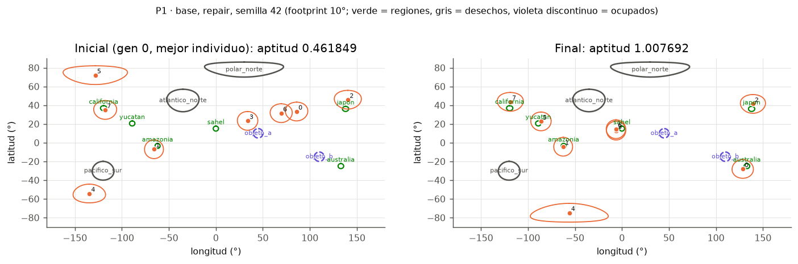

**Interpretación.** La solución es válida y cubre las 6 regiones, así que cumple el criterio de
suficiencia; la aptitud pasa de 0.461849 (mejor individuo de la generación 0) a 1.007692. Cada región
tiene su propio satélite, como exige la geometría (§4.5: ningún par de regiones cabe en un footprint de
10°). La brecha de 0.015385 frente al óptimo se explica en la tabla: los dos satélites libres no se usan
como el óptimo los usaría. Uno se duplica sobre Sahel (prioridad Media) y el otro queda en
(-74.802, -55.991), donde no cubre nada. El óptimo pondría los dos extra en Yucatán y Amazonía (Alta).
Esta ejecución reproduce exactamente `results/base_repair_s42.json` de la Ola 2, generado con otra
versión de numpy (última línea de la tabla).

**Fallos y efecto sobre la validez.** Ninguno en validez ni en cobertura (0 violaciones finales). La
solución no es óptima: la redundancia está en una región de prioridad Media y sobra un satélite. Eso
solo afecta al bono de redundancia (β = 0.05), no al criterio de suficiencia.

### P2 · Evolución

**Condiciones.** Base × {penalty, repair, strict} × 30 semillas, 100 × 200. Línea base: búsqueda
aleatoria uniforme con el **mismo presupuesto** (20 100 configuraciones por semilla, aptitud penalty,
mismas 30 semillas). Las curvas son la mediana y el rango intercuartílico de `history[g].best` entre
semillas. Criterio: el AG supera a la aleatoria en ≥ 29/30 semillas.

<!-- tabla:p2_resumen -->
| config | best med. g0 | best med. g10 | best med. g25 | best med. g50 | best med. g100 | best med. g200 | gen_99 med. | gen 6/6 válida med. | alcanzan 6/6 válida | AG > aleatoria (misma semilla) |
|---|---|---|---|---|---|---|---|---|---|---|
| base_penalty | 0.3577 | 0.7627 | 0.9538 | 1.0077 | 1.0115 | 1.0154 | 33.0 | 24.0 | 23/30 | 30/30 |
| base_repair | 0.3726 | 0.7692 | 0.9773 | 1.0077 | 1.0115 | 1.0154 | 33.5 | 26.0 | 25/30 | 30/30 |
| base_strict | 0.3577 | 0.7627 | 0.9807 | 1.0096 | 1.0115 | 1.0154 | 33.0 | 24.0 | 24/30 | 30/30 |

| línea base | n semillas | evaluaciones | máx. mediano | máx. de máx. | media de p95 | media de la media | éxito 6/6 |
|---|---|---|---|---|---|---|---|
| aleatoria uniforme (penalty) | 30 | 20100 | 0.6154 | 0.7692 | 0.2308 | -0.0481 | 0/30 |
<!-- /tabla -->

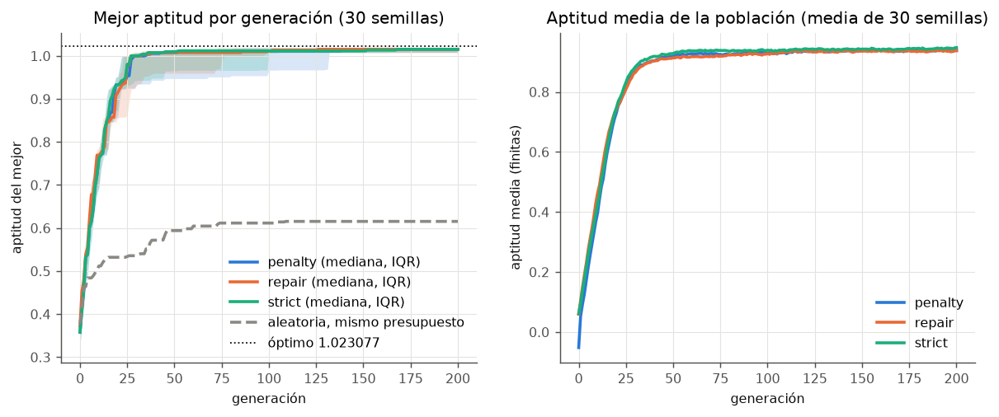

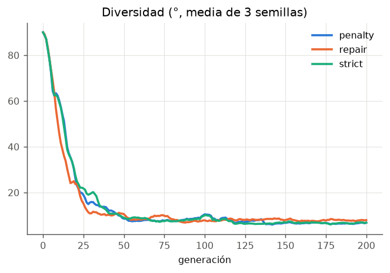 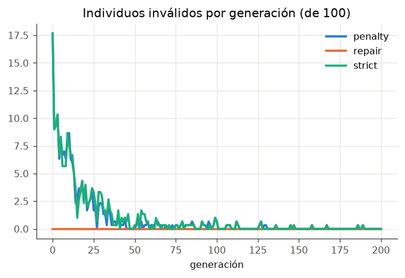

**Interpretación.** **PASA**: el AG supera a la búsqueda aleatoria en 30/30 semillas en los tres modos.
La aleatoria se estanca en un máximo mediano de 0.6154 (la mejor de las 30 llega a 0.7692) y no
alcanza nunca 6/6 (0/30). El AG supera la aptitud 1.0 (6/6 cubiertas) hacia la generación 25-50
(mediana del mejor 1.0077 en g50) y alcanza el 99 % de su aptitud final hacia la generación 33
(`gen_99` mediano 33.0-33.5). De la generación 100 a la 200 la mediana del mejor apenas cambia
(1.0115 → 1.0154). La diversidad decrece en tendencia, aunque no de forma estrictamente monótona
(sube en algunas generaciones), y la población converge. La media de la
población y el número de inválidos muestran que las restricciones actúan al principio: en la
generación 0 hay en promedio 20.0 de 100 individuos inválidos en penalty y strict (P3), y 0.0 en
repair, porque la población inicial se repara.

**Fallos y efecto sobre la validez.** Que la curva se aplane no prueba optimalidad: la mediana final
(1.0154) queda por debajo del óptimo 1.023077 (P7). No se observó ningún fallo de ejecución.

### P3 · Zonas de desechos

**Condiciones.** Base y reducido × 3 modos × 30 semillas (180 ejecuciones). Se cuentan las violaciones
finales de tipo `debris` (§5.4) y el margen mínimo `min_margin_deg = min_{i,z}(d(sat_i, z) − r_z)` sobre
todas las zonas (< 0 = violación; ≈ 0 = restricción activa). Criterio: 0 violaciones finales en repair y
strict; en penalty se informa el conteo real.

<!-- tabla:p3_violaciones -->
| config | ejecuciones | violaciones finales (debris) | ejecuciones con ≥1 | inválidos gen 0 (media de 100) | margen mín. mediano (°) | margen mín. menor (°) |
|---|---|---|---|---|---|---|
| base_penalty | 30 | 0 | 0 | 20.0 | 18.50 | 7.12 |
| base_repair | 30 | 0 | 0 | 0.0 | 18.94 | 0.25 |
| base_strict | 30 | 0 | 0 | 20.0 | 18.42 | 7.12 |
| reducido_penalty | 30 | 0 | 0 | 39.8 | 4.46 | 1.91 |
| reducido_repair | 30 | 0 | 0 | 0.0 | 1.53 | 0.24 |
| reducido_strict | 30 | 0 | 0 | 39.8 | 4.05 | 0.10 |
<!-- /tabla -->

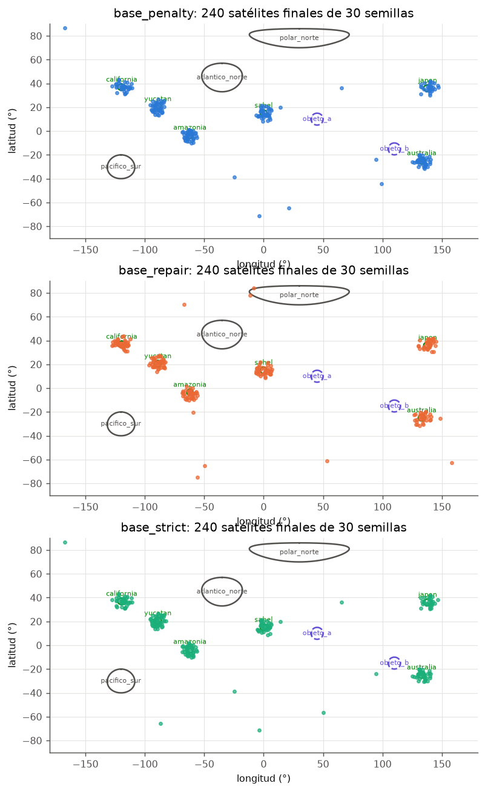

**Interpretación.** **PASA**: 0 violaciones finales de desechos en las 90 ejecuciones, también en penalty
(K = 0.5 > 3/13 + β, §4.3: ninguna violación "se paga" con cobertura). Las restricciones **actúan
durante la búsqueda**: 20.0 de 100 individuos de la generación 0 son inválidos en penalty y strict,
igual que el ≈ 20 % que predice el contrato (§4.5). Pero **no están activas en el óptimo base**: el
margen mínimo mediano de las soluciones finales es de 18.42-18.94°, muy cerca de los 18.76° entre
Australia y el borde de `objeto_b` del contrato. El margen más pequeño observado (0.25° en repair)
corresponde a un satélite que quedó junto al borde de una zona sin violarla. `repair` deja los satélites
que repara a radio + 0.5° del centro, así que en ese modo los márgenes pequeños son de esperar. En esa
semilla las 6 regiones siguen cubiertas (`exp_runs/base.csv`).

En **reducido** las zonas son más grandes y hay una nueva junto a Australia, y se nota en las dos
fases. En la búsqueda, los inválidos de la generación 0 casi se duplican (39.8 de 100 en penalty y
strict, frente a 20.0 en base). En las soluciones finales, el margen mínimo mediano baja de 18.42-18.94°
a 1.53-4.46°, y el menor llega a 0.10° (strict) y 0.24° (repair): los satélites trabajan pegados a una
zona. Aun así hay **0 violaciones finales de desechos en las 90 ejecuciones de reducido**, también en
penalty. La zona que fija el margen es casi siempre `bloqueo_australia_este` (P5).

**Fallos y efecto sobre la validez.** Ninguno observado: 0/180 ejecuciones con violaciones de desechos.
En base la prueba no demuestra el manejo de una restricción activa (no lo está); en reducido sí hay
satélites a menos de 1° de una zona y ninguno la viola.

### P4 · Posiciones ocupadas

**Condiciones.** Las mismas que en P3, con las violaciones de tipo `occupied` (`objeto_a`, `objeto_b`).
Mismo mapa de P3 (contornos violetas discontinuos). Base y reducido (donde `objeto_a` y `objeto_b`
pasan de 5° a 7.5° de radio).

<!-- tabla:p4_violaciones -->
| config | ejecuciones | violaciones finales (occupied) | ejecuciones con ≥1 | inválidos gen 0 (media de 100) | margen mín. mediano (°) | margen mín. menor (°) |
|---|---|---|---|---|---|---|
| base_penalty | 30 | 0 | 0 | 20.0 | 18.50 | 7.12 |
| base_repair | 30 | 0 | 0 | 0.0 | 18.94 | 0.25 |
| base_strict | 30 | 0 | 0 | 20.0 | 18.42 | 7.12 |
| reducido_penalty | 30 | 0 | 0 | 39.8 | 4.46 | 1.91 |
| reducido_repair | 30 | 0 | 0 | 0.0 | 1.53 | 0.24 |
| reducido_strict | 30 | 0 | 0 | 39.8 | 4.05 | 0.10 |
<!-- /tabla -->

**Interpretación.** **PASA**: 0 violaciones finales de objetos ocupados en las 180 ejecuciones (base y
reducido, 3 modos). Las columnas de inválidos y margen son las de P3, porque se calculan sobre todas las
zonas: el margen mínimo no distingue el tipo de zona. Los objetos ocupados no compiten con ninguna
región por el espacio útil, ni siquiera agrandados en reducido: el margen mínimo nunca lo fija un objeto
ocupado (tabla de zonas de P5).

**Fallos y efecto sobre la validez.** Ninguno observado.

### P5 · Espacio reducido

**Condiciones.** `scenarios/reducido.json` × 3 modos × 30 semillas (42-71), 100 × 200, comparado con
las mismas semillas en base. Radios originales × 1.5 y la zona nueva `bloqueo_australia_este`, que
corta el casquete de cobertura completa de Australia sin taparlo (1D estima que elimina el 29 % de las
posiciones que la cubren completa). El óptimo sigue siendo 1.023077 (§10 de 1.0.2): el centro de
Australia queda fuera de la zona.

**Criterio.** Restricción activa: mediana de `min_margin_deg` < 1° en reducido frente a > 10° en base;
tasa de éxito y caída de aptitud frente a base; 0 violaciones finales en repair y strict.

<!-- tabla:p5_resumen -->
| modo | margen mín. mediano reducido (°) | margen mín. mediano base (°) | restricción activa (< 1° vs > 10°) | éxito reducido [IC 95 %] | éxito base | aptitud mediana reducido | aptitud mediana base | caída de la mediana | violaciones finales | 0 violaciones (repair/strict) |
|---|---|---|---|---|---|---|---|---|---|---|
| penalty | 4.46 | 18.50 | FALLA | 24/30 [0.63, 0.90] | 23/30 | 1.0096 | 1.0154 | 0.0058 | 0 | — |
| repair | 1.53 | 18.94 | FALLA | 27/30 [0.74, 0.97] | 25/30 | 1.0173 | 1.0154 | -0.0019 | 0 | PASA |
| strict | 4.05 | 18.42 | FALLA | 27/30 [0.74, 0.97] | 24/30 | 1.0135 | 1.0154 | 0.0019 | 0 | PASA |

| config | n | media | sd | mediana | IQR | mín | máx | éxito k/n [IC Wilson 95 %] |
|---|---|---|---|---|---|---|---|---|
| reducido_penalty | 30 | 0.9940 | 0.0431 | 1.0096 | 1.0038–1.0154 | 0.8538 | 1.0231 | 24/30 [0.63, 0.90] |
| reducido_repair | 30 | 1.0051 | 0.0384 | 1.0173 | 1.0125–1.0192 | 0.8692 | 1.0231 | 27/30 [0.74, 0.97] |
| reducido_strict | 30 | 1.0050 | 0.0318 | 1.0135 | 1.0115–1.0192 | 0.8731 | 1.0231 | 27/30 [0.74, 0.97] |

| config | alcanzan el óptimo (brecha < 1e-6) | brecha mediana | brecha máx. |
|---|---|---|---|
| reducido_penalty | 3/30 | 0.013462 | 0.169231 |
| reducido_repair | 3/30 | 0.005769 | 0.153846 |
| reducido_strict | 4/30 | 0.009615 | 0.150000 |
<!-- /tabla -->

Zona que fija el margen mínimo de cada ejecución final (desde `exp_runs/finales_reducido.csv`):

<!-- tabla:p5_zonas -->
| config | zona que fija el margen mínimo | ejecuciones | margen mediano (°) | margen menor (°) | < 1° |
|---|---|---|---|---|---|
| reducido_penalty | bloqueo_australia_este | 26 | 4.10 | 1.91 | 0 |
| reducido_penalty | atlantico_norte | 3 | 22.22 | 18.52 | 0 |
| reducido_penalty | pacifico_sur | 1 | 17.75 | 17.75 | 0 |
| reducido_repair | bloqueo_australia_este | 28 | 1.53 | 0.24 | 10 |
| reducido_repair | atlantico_norte | 2 | 10.53 | 0.50 | 1 |
| reducido_strict | bloqueo_australia_este | 28 | 3.96 | 0.10 | 3 |
| reducido_strict | atlantico_norte | 2 | 23.79 | 22.22 | 0 |
<!-- /tabla -->

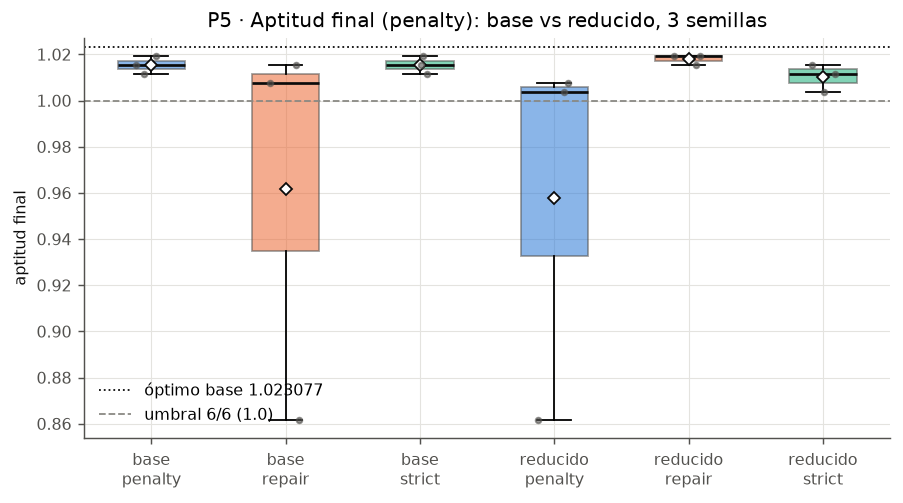

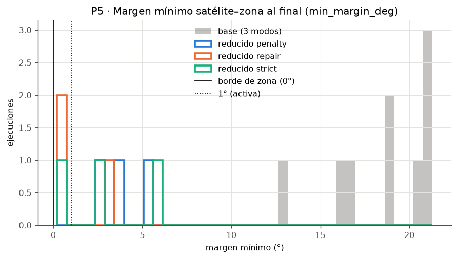

**Interpretación.** El criterio de margen **FALLA en los tres modos**: la mediana de `min_margin_deg`
en reducido es 4.46° (penalty), 1.53° (repair) y 4.05° (strict), por encima de 1°, aunque muy por debajo
de los 18.42-18.94° de base. La restricción sí actúa: `bloqueo_australia_este` es la zona más cercana
en 26/30 (penalty) y 28/30 (repair, strict) de las soluciones finales, y en 10 de las 28 de repair el
satélite queda a menos de 1° de ella. Lo que no ocurre es que el óptimo *obligue* a apoyarse en el borde:
cubrir Australia completa admite cualquier posición a menos de 7.3° de su centro, y la zona solo quita
la parte este de ese casquete. La mayoría de las soluciones cubre Australia desde la parte que queda
libre, con margen de varios grados. El umbral de 1° del plan suponía una restricción ligada en el óptimo, y este escenario (el del
ejemplo del contrato) no la tiene. repair es el modo con márgenes más pequeños porque deja los
satélites que repara a radio + 0.5° del centro de la zona.

En aptitud, reducido **no** es más difícil que base con estos parámetros: el éxito es 24/30, 27/30 y
27/30 frente a 23/30, 25/30 y 24/30, y la caída de la mediana es de 0.0058 (penalty), −0.0019 (repair) y
0.0019 (strict). Los intervalos de Wilson se solapan con los de base, así que la diferencia de éxito no
es significativa con 30 semillas. El óptimo 1.023077 se alcanza en 3/30 (penalty, repair) y 4/30
(strict) semillas, una proporción parecida a la de base (2/30, P7). Las 90 soluciones finales son
válidas y repair y strict cumplen 0 violaciones.

**Fallos y efecto sobre la validez.** El criterio de margen falla, pero por cómo se fijó el umbral, no
por el sistema: no hay violaciones y la aptitud no cae. La conclusión válida es más débil que la
prevista: el AG maneja una zona que recorta el espacio útil de una región (la evita en el 100 % de los
casos sin perder la región en la mayoría), pero esta prueba no muestra su comportamiento cuando el
óptimo exige quedar sobre el borde.

### P6 · Escenario inviable

**Condiciones.** `scenarios/inviable.json` × 3 modos × 30 semillas, 100 × 200. La zona
`bloqueo_yucatan` (radio 13° > F + r = 12.7°) hace imposible cubrir Yucatán, ni siquiera parcialmente,
sin violar.

**Criterio.** Ningún final válido toca Yucatán (`cov_yucatan == 0`); ninguna aptitud supera el óptimo
0.796154 (§10 de 1.0.2); se informa la tasa con brecha < 0.01. El resultado esperado es un **fallo del
criterio de suficiencia** (no hay 6/6 posibles), no un fallo del sistema.

<!-- tabla:p6_resumen -->
| modo | ejecuciones | válidas | válidas con cov_yucatan = 0 | aptitud penalty máx. | ≤ 0.796154 | brecha < 0.01 [IC 95 %] | éxito 6/6 | veredicto |
|---|---|---|---|---|---|---|---|---|
| penalty | 30 | 30/30 | 30/30 | 0.796154 | 30/30 | 22/30 [0.56, 0.86] | 0/30 | PASA |
| repair | 30 | 30/30 | 30/30 | 0.796154 | 30/30 | 29/30 [0.83, 0.99] | 0/30 | PASA |
| strict | 30 | 30/30 | 30/30 | 0.796154 | 30/30 | 21/30 [0.52, 0.83] | 0/30 | PASA |

| config | n | media | sd | mediana | IQR | mín | máx | éxito k/n [IC Wilson 95 %] |
|---|---|---|---|---|---|---|---|---|
| inviable_penalty | 30 | 0.7894 | 0.0050 | 0.7885 | 0.7856–0.7923 | 0.7769 | 0.7962 | 0/30 [0.00, 0.11] |
| inviable_repair | 30 | 0.7922 | 0.0046 | 0.7923 | 0.7923–0.7962 | 0.7731 | 0.7962 | 0/30 [0.00, 0.11] |
| inviable_strict | 30 | 0.7887 | 0.0046 | 0.7885 | 0.7846–0.7923 | 0.7769 | 0.7962 | 0/30 [0.00, 0.11] |

| config | alcanzan el óptimo (brecha < 1e-6) | brecha mediana | brecha máx. |
|---|---|---|---|
| inviable_penalty | 5/30 | 0.007692 | 0.019231 |
| inviable_repair | 10/30 | 0.003846 | 0.023077 |
| inviable_strict | 4/30 | 0.007692 | 0.019231 |
<!-- /tabla -->

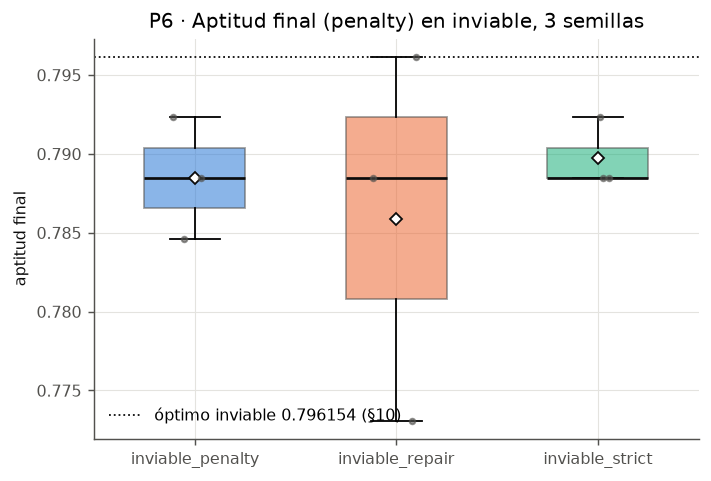

**Interpretación.** **PASA en los tres modos.** Las 90 soluciones finales son válidas y ninguna toca
Yucatán (30/30 con `cov_yucatan = 0` en cada modo): el AG abandona la región imposible en lugar de
violar `bloqueo_yucatan`, también en penalty, donde una violación sería posible pero cuesta K = 0.5,
más que lo que aporta Yucatán. Las otras 5 regiones se cubren en el 100 % de las semillas
(`regiones_cubiertas`). Ninguna aptitud supera el óptimo 0.796154 y los tres modos lo alcanzan (máx.
0.796154): repair en 10/30 semillas, penalty en 5/30 y strict en 4/30. repair queda además más cerca
del óptimo (brecha < 0.01 en 29/30 frente a 22/30 y 21/30; brecha mediana 0.003846 frente a 0.007692).
El criterio de suficiencia (6/6) falla en 0/30, que es lo esperado: no es un fallo del sistema sino la
condición inviable que la prueba busca mostrar.

**Fallos y efecto sobre la validez.** Ninguno del sistema. **Discrepancia con el contrato,
registrada:** la primera corrida se evaluó con el oráculo del contrato 1.0.1 (0.788462) y el criterio
"aptitud ≤ 0.788462" dio **FALLA en los tres modos**: 14 (penalty), 23 (repair) y 10 (strict) de 30
soluciones válidas lo superaban, todas con 0.788462 < aptitud ≤ 0.796154 (tabla `p6_resumen` del
commit `5dd4437`). No era un error del AG: con 8 satélites y 5 regiones cubribles sobran 3, no 2, y el
óptimo es 10/13 + 0.05·7/13 = 0.796154, que `model.fitness` reproduce con una configuración válida
explícita. 1D lo detectó por su lado (P-1D-1) y el contrato 1.0.2 corrigió el oráculo; las tablas de
este documento usan ya 0.796154. Las ejecuciones son las mismas: la re-ejecución con el contrato 1.0.2
dio CSV idénticos salvo la columna `gap_opt`.

### P7 · Variación entre ejecuciones

**Condiciones.** Base × 3 modos × 30 semillas (las mismas de P2-P4). Estadísticos de la aptitud final
(penalty), tasa de éxito con IC de Wilson, porcentaje de semillas que cubren cada región y dónde
quedan los satélites redundantes.

<!-- tabla:p7_variacion -->
| config | n | media | sd | mediana | IQR | mín | máx | éxito k/n [IC Wilson 95 %] |
|---|---|---|---|---|---|---|---|---|
| base_penalty | 30 | 0.9864 | 0.0581 | 1.0154 | 1.0077–1.0192 | 0.8577 | 1.0231 | 23/30 [0.59, 0.88] |
| base_repair | 30 | 0.9868 | 0.0743 | 1.0154 | 1.0077–1.0192 | 0.7154 | 1.0231 | 25/30 [0.66, 0.93] |
| base_strict | 30 | 0.9944 | 0.0484 | 1.0154 | 1.0087–1.0192 | 0.8577 | 1.0231 | 24/30 [0.63, 0.90] |

| config | alcanzan el óptimo (brecha < 1e-6) | brecha mediana | brecha máx. |
|---|---|---|---|
| base_penalty | 2/30 | 0.007692 | 0.165385 |
| base_repair | 2/30 | 0.007692 | 0.307692 |
| base_strict | 2/30 | 0.007692 | 0.165385 |
<!-- /tabla -->

Regiones cubiertas (`% de semillas con c == 1.0 (media de c)`):

<!-- tabla:regiones_cubiertas -->
| escenario | modo | yucatan | amazonia | california | sahel | japon | australia | 6/6 cubiertas |
|---|---|---|---|---|---|---|---|---|
| base | penalty | 100 % (1.000) | 100 % (1.000) | 97 % (0.967) | 93 % (0.933) | 93 % (0.933) | 93 % (0.933) | 23/30 |
| base | repair | 100 % (1.000) | 100 % (1.000) | 97 % (0.967) | 97 % (0.967) | 90 % (0.900) | 93 % (0.933) | 25/30 |
| base | strict | 100 % (1.000) | 100 % (1.000) | 100 % (1.000) | 93 % (0.933) | 97 % (0.967) | 90 % (0.900) | 24/30 |
| reducido | penalty | 100 % (1.000) | 100 % (1.000) | 93 % (0.933) | 100 % (1.000) | 100 % (1.000) | 87 % (0.867) | 24/30 |
| reducido | repair | 100 % (1.000) | 100 % (1.000) | 100 % (1.000) | 93 % (0.933) | 100 % (1.000) | 97 % (0.967) | 27/30 |
| reducido | strict | 100 % (1.000) | 100 % (1.000) | 97 % (0.967) | 100 % (1.000) | 100 % (1.000) | 93 % (0.933) | 27/30 |
| inviable | penalty | 0 % (0.000) | 100 % (1.000) | 100 % (1.000) | 100 % (1.000) | 100 % (1.000) | 100 % (1.000) | 0/30 |
| inviable | repair | 0 % (0.000) | 100 % (1.000) | 100 % (1.000) | 100 % (1.000) | 100 % (1.000) | 100 % (1.000) | 0/30 |
| inviable | strict | 0 % (0.000) | 100 % (1.000) | 100 % (1.000) | 100 % (1.000) | 100 % (1.000) | 100 % (1.000) | 0/30 |
<!-- /tabla -->

Dónde cae la redundancia (regiones con ≥ 2 satélites que las cubren completas):

<!-- tabla:p7_redundancia -->
| config | regiones con ≥2 satélites que las cubren completas | semillas |
|---|---|---|
| base_penalty | yucatan+australia | 5 |
| base_penalty | amazonia | 3 |
| base_penalty | amazonia+japon | 2 |
| base_penalty | amazonia+sahel | 2 |
| base_penalty | california+australia | 2 |
| base_penalty | sahel | 2 |
| base_penalty | sahel+australia | 2 |
| base_penalty | yucatan+amazonia | 2 |
| base_penalty | yucatan+amazonia+california | 2 |
| base_penalty | yucatan+california | 2 |
| base_penalty | yucatan+sahel | 2 |
| base_penalty | amazonia+australia | 1 |
| base_penalty | amazonia+sahel+australia | 1 |
| base_penalty | sahel+japon | 1 |
| base_penalty | yucatan+amazonia+australia | 1 |
| base_repair | yucatan+sahel | 4 |
| base_repair | amazonia+japon | 3 |
| base_repair | yucatan+amazonia | 3 |
| base_repair | amazonia+australia | 2 |
| base_repair | amazonia+sahel | 2 |
| base_repair | california+sahel | 2 |
| base_repair | japon | 2 |
| base_repair | sahel | 2 |
| base_repair | yucatan+california | 2 |
| base_repair | yucatan+japon | 2 |
| base_repair | amazonia | 1 |
| base_repair | california+australia | 1 |
| base_repair | california+japon | 1 |
| base_repair | yucatan+amazonia+california+sahel | 1 |
| base_repair | yucatan+australia | 1 |
| base_repair | yucatan+california+australia | 1 |
| base_strict | yucatan+australia | 5 |
| base_strict | yucatan+sahel | 4 |
| base_strict | amazonia | 3 |
| base_strict | amazonia+sahel | 2 |
| base_strict | california+australia | 2 |
| base_strict | sahel | 2 |
| base_strict | yucatan+amazonia | 2 |
| base_strict | yucatan+amazonia+california | 2 |
| base_strict | yucatan+california | 2 |
| base_strict | amazonia+australia | 1 |
| base_strict | amazonia+california+sahel | 1 |
| base_strict | amazonia+japon | 1 |
| base_strict | sahel+australia | 1 |
| base_strict | yucatan | 1 |
| base_strict | yucatan+amazonia+australia | 1 |
<!-- /tabla -->

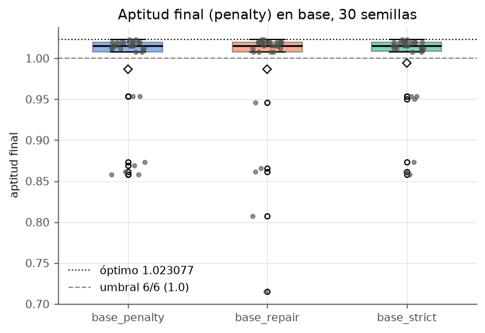

**Interpretación.** La mediana es la misma en los tres modos (1.0154), pero la dispersión es real: las
semillas van de 0.7154 a 1.0231 en repair. La tasa de éxito es de 23/30 (penalty), 25/30 (repair) y
24/30 (strict), con intervalos de Wilson que se solapan. Solo 2/30 semillas por modo alcanzan el óptimo
1.023077 (brecha mediana 0.007692). Las regiones Alta (Yucatán, Amazonía) se cubren en el 100 % de las
semillas en los tres modos. Las que se pierden son de prioridad Media o Normal (California, Sahel,
Japón, Australia: 90-100 %). Eso es coherente con los pesos: perder una Alta cuesta más. La tabla de
redundancia muestra **óptimos locales distintos**: la combinación del óptimo (`yucatan+amazonia`)
aparece solo en 2-3 semillas por modo, y los satélites extra caen en muchas combinaciones
(`yucatan+australia`, `yucatan+sahel`, `amazonia+japon`…). El cruce por índice y el bono pequeño
(β = 0.05) dan poca presión para mover la redundancia hacia las regiones Alta.

**Fallos y efecto sobre la validez.** Entre 5 y 7 semillas de cada 30 **no cumplen el criterio de
suficiencia** (no cubren 6/6), aunque todas son válidas. La peor (repair, semilla 68, 0.715385) deja sin
cubrir Sahel y Japón y pone la redundancia en Yucatán, California y Australia (fila de
`exp_runs/base.csv`; patrón `yucatan+california+australia` de la tabla de redundancia). Una sola
ejecución no basta para garantizar una solución suficiente. Con estos
parámetros conviene ejecutar varias semillas y quedarse con la mejor, o usar una población mayor
(P10).

## 4. Pruebas propias

### P8 · penalty vs repair vs strict

**Condiciones.** Las ejecuciones de base, reducido e inviable (270, mismas semillas en los tres
modos). Para cada escenario y modo: éxito con IC de Wilson, aptitud penalty mediana y media, finales
válidas, generación mediana en la que el mejor es 6/6 y válido, y la diferencia de medianas frente a
penalty con IC bootstrap al 95 %.

<!-- tabla:p8_modos -->
| escenario | modo | éxito [IC 95 %] | aptitud penalty mediana | media | válidas | gen 6/6 válida mediana | Δ mediana vs penalty [IC bootstrap 95 %] |
|---|---|---|---|---|---|---|---|
| base | penalty | 23/30 [0.59, 0.88] | 1.0154 | 0.9864 | 30/30 | 24.0 | — |
| base | repair | 25/30 [0.66, 0.93] | 1.0154 | 0.9868 | 30/30 | 26.0 | +0.0000 [-0.0038, +0.0077] |
| base | strict | 24/30 [0.63, 0.90] | 1.0154 | 0.9944 | 30/30 | 24.0 | +0.0000 [-0.0038, +0.0058] |
| reducido | penalty | 24/30 [0.63, 0.90] | 1.0096 | 0.9940 | 30/30 | 28.5 | — |
| reducido | repair | 27/30 [0.74, 0.97] | 1.0173 | 1.0051 | 30/30 | 26.0 | +0.0077 [+0.0038, +0.0135] |
| reducido | strict | 27/30 [0.74, 0.97] | 1.0135 | 1.0050 | 30/30 | 31.0 | +0.0038 [+0.0000, +0.0115] |
| inviable | penalty | 0/30 [0.00, 0.11] | 0.7885 | 0.7894 | 30/30 | — | — |
| inviable | repair | 0/30 [0.00, 0.11] | 0.7923 | 0.7922 | 30/30 | — | +0.0038 [+0.0000, +0.0058] |
| inviable | strict | 0/30 [0.00, 0.11] | 0.7885 | 0.7887 | 30/30 | — | +0.0000 [-0.0038, +0.0019] |
<!-- /tabla -->

**Interpretación.** En el escenario base **los tres modos son equivalentes**: las tres medianas valen
1.0154, los IC bootstrap de la diferencia contienen 0 (repair − penalty: [-0.0038, +0.0077];
strict − penalty: [-0.0038, +0.0058]), los intervalos de Wilson del éxito se solapan y las 30/30
finales son válidas en los tres. La velocidad también es parecida: el mejor es 6/6 válido en la
generación mediana 24.0 (penalty, strict) y 26.0 (repair). Era lo esperable, porque las restricciones
no están activas en el óptimo base (P3). El manejo de restricciones solo cambia la fase inicial: con
repair no hay inválidos (P2).

Cuando las zonas recortan el espacio útil (**reducido**), **repair es el mejor modo**: su mediana supera
a la de penalty en +0.0077 con IC bootstrap [+0.0038, +0.0135], que excluye el 0, y su éxito es 27/30
frente a 24/30. strict también mejora a penalty (+0.0038), pero su IC [+0.0000, +0.0115] toca el 0 y
tarda más en llegar a 6/6 válida (generación mediana 31.0 frente a 26.0 en repair y 28.5 en penalty). Una
explicación coherente con P3: en reducido casi 40 de 100 individuos iniciales son inválidos; penalty los
conserva con aptitud baja y strict los descarta, mientras que repair los convierte en válidos cerca del
borde, justo donde está el espacio que la zona nueva deja libre.

En **inviable**, ningún modo alcanza 6/6 (0/30 en los tres; es imposible) y las 90 finales son válidas.
repair vuelve a tener la mediana más alta (+0.0038 [+0.0000, +0.0058] frente a penalty), con el IC
tocando el 0; strict no se distingue de penalty (+0.0000 [-0.0038, +0.0019]).

**Fallos y efecto sobre la validez.** Ninguno. Una diferencia real menor que ≈ 0.004-0.008 no se
distinguiría con 30 semillas (ancho de los IC); por eso solo la ventaja de repair en reducido se
afirma como significativa.

### P9 · Sensibilidad al footprint

**Condiciones.** Copias en memoria de base con F ∈ {5, 7.5, 10, 12.5, 15, 20}° (id `base_f<F>`), modo
repair, 100 generaciones (P = 100), 30 semillas. F = 5 coincide con `footprint_chico` (§4.6) y F = 20
supera el umbral trivial de 18.2° (§4.5). El óptimo 1.023077 es oráculo para F < 18.2° (§10 de 1.0.2,
P-1D-4): la brecha se informa solo para F = 5 y F = 10, y para F = 20 deja de ser cota superior (el
contrato da 1.038462 con F = 20). Como en `footprint_chico` (P-1D-3), con F = 5 las restricciones siguen
inactivas en el óptimo (cubrir completa exige d ≤ 2.3° y el centro de región más cercano está a 18.76°
del borde de una zona): lo que cambia es la dificultad de la búsqueda.

<!-- tabla:p9_footprint -->
| F (°) | config | gens | éxito [IC 95 %] | aptitud mediana | mín | máx | = 1.023077 | gen 6/6 válida med. | best gen 0 (media) | regiones redundantes (media) |
|---|---|---|---|---|---|---|---|---|---|---|
| 5.0 | base_f5_repair | 100 | 10/30 [0.19, 0.51] | 0.9346 | 0.7692 | 1.0115 | 0/30 | 50.0 | 0.2360 | 0.57 |
| 7.5 | base_f7_5_repair | 100 | 22/30 [0.56, 0.86] | 1.0096 | 0.8538 | 1.0231 | 1/30 | 36.5 | 0.2970 | 1.43 |
| 10.0 | base_f10_repair | 100 | 25/30 [0.66, 0.93] | 1.0115 | 0.7154 | 1.0231 | 2/30 | 26.0 | 0.3670 | 1.70 |
| 12.5 | base_f12_5_repair | 100 | 27/30 [0.74, 0.97] | 1.0192 | 0.9462 | 1.0231 | 4/30 | 19.0 | 0.4358 | 1.83 |
| 15.0 | base_f15_repair | 100 | 26/30 [0.70, 0.95] | 1.0192 | 0.8577 | 1.0231 | 10/30 | 16.5 | 0.5056 | 2.10 |
| 20.0 | base_f20_repair | 100 | 30/30 [0.89, 1.00] | 1.0346 | 1.0269 | 1.0385 | 0/30 | 10.0 | 0.6702 | 3.63 |
<!-- /tabla -->

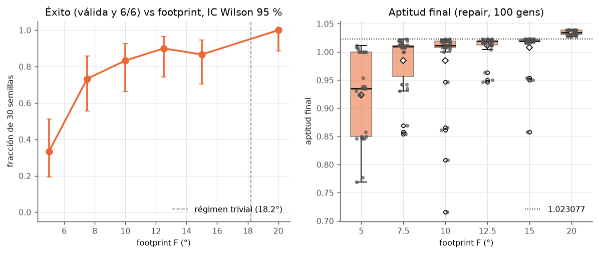

**Interpretación.** La dificultad depende mucho de F. Con F = 5 el éxito cae a 10/30 [0.19, 0.51] y
ninguna semilla alcanza 1.023077: cubrir completa exige d ≤ 2.3°, y la señal de la aptitud es muy
escasa (mejor de la generación 0: 0.2360 de media). Entre F = 7.5 y 15 el éxito sube de 22/30 a
26-27/30 y llegar a 6/6 válida cuesta cada vez menos (mediana de la generación 36.5 → 16.5). Con F = 20
se cumple 30/30 y la aptitud mínima ya es 1.0269, **por encima del óptimo de F = 10**: un satélite
cubre dos regiones (Yucatán-California), sobran satélites y la redundancia media sube a 3.63 regiones.
El problema se trivializa, como anticipa el contrato. La columna "= 1.023077" vale 0/30 en F = 20
porque allí el óptimo es otro (máx. observado 1.0385, igual al 1.038462 que da el contrato para F = 20),
no porque falle: esa columna solo tiene sentido para F < 18.2°. F = 10 queda en la zona
intermedia: no es trivial y tampoco es imposible. Con 100 generaciones logra el mismo éxito (25/30) que
con 200 en P7, otra señal de que la segunda mitad de las generaciones aporta poco.

**Fallos y efecto sobre la validez.** En F = 5, 20/30 ejecuciones no cumplen el criterio de suficiencia:
el `footprint_chico` es difícil para estos parámetros. Es una limitación del AG, no un error, y no
viene de las restricciones (inactivas en ese óptimo). Todas las soluciones siguen siendo válidas.

### P10 · Sensibilidad al tamaño de población (presupuesto fijo)

**Condiciones.** Base, repair, 30 semillas, P ∈ {20, 50, 100, 200} con gens = 20 000 / P, de modo que
P·(gens + 1) ≈ 20 100 evaluaciones en todas. El `--bench` proyectó menos de 30 min con 16 procesos, así
que **no se aplicó la regla de corte** del presupuesto (§1.4 del plan). La configuración P = 100 es la
misma que `base_repair` (mismas semillas y resultados idénticos: 25/30 en ambas tablas).

<!-- tabla:p10_poblacion -->
| P | gens | evaluaciones | éxito [IC 95 %] | aptitud mediana | IQR | óptimo alcanzado | gen_99 med. | diversidad final media (°) |
|---|---|---|---|---|---|---|---|---|
| 20 | 1000 | 20020 | 5/30 [0.07, 0.34] | 0.8538 | 0.7279–0.8654 | 0/30 | 135.0 | 5.36 |
| 50 | 400 | 20050 | 15/30 [0.33, 0.67] | 0.9788 | 0.8654–1.0154 | 6/30 | 46.5 | 6.56 |
| 100 | 200 | 20100 | 25/30 [0.66, 0.93] | 1.0154 | 1.0077–1.0192 | 2/30 | 33.5 | 7.34 |
| 200 | 100 | 20200 | 30/30 [0.89, 1.00] | 1.0192 | 1.0163–1.0231 | 9/30 | 31.5 | 7.95 |
<!-- /tabla -->

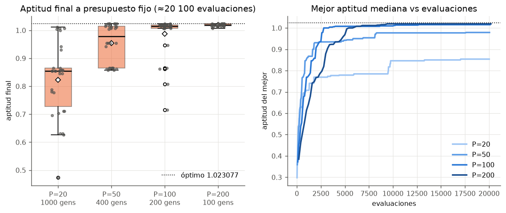

**Interpretación.** A presupuesto fijo, **más población y menos generaciones es mejor**: el éxito sube de
5/30 (P = 20, 1000 generaciones) a 15/30, 25/30 y **30/30 con P = 200** (100 generaciones), y P = 200
alcanza el óptimo en 9/30 semillas, frente a 2/30 con P = 100. Con P = 20 el AG converge pronto a un
óptimo local (diversidad final media 5.36°) y 1000 generaciones no lo sacan de ahí. La diversidad final
crece con P (5.36° → 7.95°). La curva mediana frente a evaluaciones muestra que P = 200 empieza más
lento pero termina más alto. El `DEFAULT_PARAMS` del contrato (100 × 200) queda en el lado explotador:
para la misma cantidad de cómputo, 200 × 100 da soluciones suficientes con mayor fiabilidad.

**Fallos y efecto sobre la validez.** Con P = 20 solo 5/30 ejecuciones son suficientes. No es un
error, pero sí la razón principal de las fallas de P7: la convergencia prematura. Todas las
soluciones son válidas.

### P11 · Revalidación base → escenarios derivados

**Condiciones.** `revalidate(exp_json/base_repair_s42.json, scenarios/<d>.json)` para
d ∈ {reducido, inviable, prioridad_cambiada, menos_sats, footprint_chico}, sin reoptimizar
(`python experiments/run_experiments.py --reval`). Se escribe
`results/exp_reval/reval_base_repair_s42__<d>.json` y la tabla `p11_revalidacion`.

**Criterio (coherencia con §4.6).** `prioridad_cambiada`: `still_valid = true` (solo cambian pesos) y la
aptitud cambia. `menos_sats`: `still_valid = false` con razón `n_sats: 8 != 4`. `inviable`: el satélite de
Yucatán cae dentro de `bloqueo_yucatan`, así que `still_valid = false` con violaciones. `reducido`:
depende de si algún satélite queda dentro de las zonas agrandadas o nuevas. `footprint_chico`: sigue
válida pero pierde regiones (`lost_regions` no vacío), porque cubrir completa exige d ≤ 2.3°.

<!-- tabla:p11_revalidacion -->
| escenario nuevo | still_valid | razones | zonas violadas | aptitud antes | aptitud después | perdidas | ganadas | coherente con §4.6 |
|---|---|---|---|---|---|---|---|---|
| reducido | sí | — | — | 1.007692 | 1.007692 | — | — | PASA |
| inviable | no | violations: 1 | bloqueo_yucatan | 1.007692 | 0.507692 | — | — | PASA |
| prioridad_cambiada | sí | — | — | 1.007692 | 1.007143 | — | — | PASA |
| menos_sats | no | n_sats: 8 != 4 | — | 1.007692 | 1.007692 | — | — | PASA |
| footprint_chico | sí | — | — | 1.007692 | 0.583835 | yucatan california sahel japon australia | — | PASA |
<!-- /tabla -->

**Interpretación.** **PASA en los 5 escenarios.** La solución de P1 sigue siendo válida en
`reducido` con la misma aptitud (1.007692): ningún satélite cae en las zonas agrandadas ni en la nueva.
En `inviable` el satélite de Yucatán queda dentro de `bloqueo_yucatan` (1 violación) y la aptitud baja
exactamente K = 0.5, de 1.007692 a 0.507692. En `prioridad_cambiada` sigue válida y la aptitud pasa a
1.007143 (Σw = 14). En `menos_sats` deja de ser válida solo por `n_sats: 8 != 4`. En `footprint_chico`
sigue válida, pero pierde 5 de las 6 regiones (solo conserva Amazonía) y la aptitud cae a 0.583835: una
solución buena con F = 10° no sirve con F = 5°. Las 5 revalidaciones coinciden campo a campo
(`still_valid`, razones, violaciones, aptitudes, cobertura nueva y regiones perdidas/ganadas) con las que 2C
dejó en `results/reval_base_repair_s42__<d>.json`.

**Fallos y efecto sobre la validez.** Ninguno. La revalidación no reoptimiza: mide cuánto se degrada
una solución ya calculada, no qué lograría el AG en el escenario nuevo (eso lo dan P5 y P6).

## 5. Hallazgos transversales

1. **Las restricciones no están activas en el óptimo base** (contrato §4.5). Actúan durante la búsqueda
   (20.0 de 100 inválidos en la generación 0, P3), pero las soluciones finales quedan a 18.42-18.94° de
   la zona más cercana (margen mediano). Por eso P3, P4 y P8 en base muestran 0 violaciones en todos los
   modos y modos equivalentes. En `reducido` las zonas sí recortan el espacio útil: el margen mediano
   baja a 1.53-4.46° y aun así hay 0 violaciones finales (P3, P4), pero el óptimo no obliga a apoyarse en
   el borde y el criterio de margen < 1° de P5 falla. En `inviable` la restricción hace imposible una
   región entera y el AG la abandona sin violar nada (P6). Con restricciones que muerden, **repair es el
   modo más eficaz** (P8, reducido).
2. **El AG es claramente mejor que el azar** (30/30 semillas, P2), pero **no es fiable en una sola
   ejecución**: entre 23/30 y 25/30 de éxito según el modo, y solo 2/30 llegan al óptimo (P7). La causa
   dominante es la convergencia prematura: los dos satélites extra se quedan en regiones de prioridad baja
   o en ninguna, y el bono β = 0.05 da poca presión para moverlos (P1, tabla de redundancia de P7). A
   igual presupuesto, una población mayor lo corrige (P10: 30/30 con P = 200).
3. **Que la curva se aplane no prueba optimalidad.** Las medianas se estancan en 1.0154 desde la
   generación 100 (P2), por debajo del óptimo 1.023077. Los oráculos de §10 y la brecha son lo que
   permite afirmarlo.
4. **Limitaciones del modelo** que se notan en los datos (para 4A): la cobertura de una región es la del
   mejor satélite (máximo, §5.2), así que dos satélites parciales no suman. La penalización cuenta
   violaciones y no mide su profundidad. El cruce por índice trata los satélites como una lista ordenada
   aunque son un conjunto, y con F ≥ 18.2° el problema se vuelve trivial (P9).
5. **Rendimiento (hallazgo de cómputo).** Medido con `--bench` en un solo proceso: una ejecución
   100 × 200 tarda 9.5 s (penalty), 16.1 s (repair) y 14.2 s (strict) (tabla de tiempos). El plan
   estimaba 3-6 s. El cuello de botella es `model.violations`, que recorre satélites y zonas en un bucle
   escalar de Python y se llama en cada evaluación de aptitud y en `stats_fn`. No se optimizó aquí
   (pertenece a `src/`); queda como propuesta para su dueño (1A). La campaña completa compartió la
   máquina con otros procesos que usaban casi toda la CPU, así que los tiempos de reloj de la tabla son
   pesimistas (ver la nota de la sección 1). La corrida de reducido e inviable, sin esa contención, tardó
   489.6 s de reloj para 180 ejecuciones con 16 procesos (42.33-43.80 s por ejecución en paralelo) y
   55.0 s más para las 18 representativas.
6. **Reproducibilidad verificada, con un alcance concreto.** Las 38 ejecuciones representativas (20 de
   la primera corrida, 18 de reducido e inviable) se re-ejecutaron y coincidieron bit a bit (si no, el
   programa aborta con código 3). `base_repair_s42` coincide con el resultado de la Ola 2 aunque se
   generó con otra versión de numpy (P1). La campaña P = 100 de P10 reproduce `base_repair` de P7.
   Las 180 ejecuciones de reducido e inviable se corrieron dos veces (antes y después de integrar el
   contrato 1.0.2, con el umbral de cobertura nuevo) y los CSV coinciden en todas las columnas salvo
   `gap_opt`, que cambió solo porque cambió el oráculo. No se ha ejecutado `--all --verify` sobre las 420
   ejecuciones de la primera corrida.
7. **Un oráculo del contrato estaba mal y los datos lo detectaron.** En `inviable` el AG encontró
   configuraciones válidas de 0.796154, por encima del 0.788462 que daba el contrato 1.0.1. 1D lo
   explicó (sobran 3 satélites, no 2) y el contrato 1.0.2 lo corrigió (P-1D-1). Es un ejemplo de por
   qué los oráculos se comprueban contra `model.fitness` con configuraciones explícitas (P6).
8. **El cambio de umbral de cobertura completa del contrato 1.0.2** (`c = 1` si d ≤ F − r) no altera
   ningún resultado versionado: recalculada con el `model` nuevo, la cobertura de `initial`, `final` y
   de cada `history[g].best_sats` de todos los resultados completos de `results/` coincide con la
   guardada, y también la aptitud y las violaciones finales (invariante 7, tolerancia 1e-9). Lo
   comprueban `tests/test_integration.py` sobre `results/*.json` y `test_exp_json_invariante_7` sobre
   `results/exp_json/`.

Resultados completos representativos (validados por `tests/test_contract.py`):

<!-- tabla:representativas -->
| archivo | config | semilla | rol | aptitud penalty |
|---|---|---|---|---|
| `exp_json/base_penalty_s45.json` | base_penalty | 45 | worst | 0.857692 |
| `exp_json/base_penalty_s48.json` | base_penalty | 48 | median | 1.015385 |
| `exp_json/base_penalty_s50.json` | base_penalty | 50 | best | 1.023077 |
| `exp_json/base_repair_s42.json` | base_repair | 42 | p1 | 1.007692 |
| `exp_json/base_repair_s53.json` | base_repair | 53 | best | 1.023077 |
| `exp_json/base_repair_s68.json` | base_repair | 68 | worst | 0.715385 |
| `exp_json/base_repair_s69.json` | base_repair | 69 | median | 1.015385 |
| `exp_json/base_strict_s45.json` | base_strict | 45 | worst | 0.857692 |
| `exp_json/base_strict_s48.json` | base_strict | 48 | median | 1.015385 |
| `exp_json/base_strict_s50.json` | base_strict | 50 | best | 1.023077 |
| `exp_json/base_f5_repair_s49.json` | base_f5_repair | 49 | median | 0.934615 |
| `exp_json/base_f7_5_repair_s43.json` | base_f7_5_repair | 43 | median | 1.011538 |
| `exp_json/base_f10_repair_s65.json` | base_f10_repair | 65 | median | 1.011538 |
| `exp_json/base_f12_5_repair_s44.json` | base_f12_5_repair | 44 | median | 1.019231 |
| `exp_json/base_f15_repair_s59.json` | base_f15_repair | 59 | median | 1.019231 |
| `exp_json/base_f20_repair_s70.json` | base_f20_repair | 70 | median | 1.034615 |
| `exp_json/base_p20_repair_s48.json` | base_p20_repair | 48 | median | 0.853846 |
| `exp_json/base_p50_repair_s47.json` | base_p50_repair | 47 | median | 1.003846 |
| `exp_json/base_p100_repair_s69.json` | base_p100_repair | 69 | median | 1.015385 |
| `exp_json/base_p200_repair_s63.json` | base_p200_repair | 63 | median | 1.019231 |
| `exp_json/reducido_penalty_s46.json` | reducido_penalty | 46 | median | 1.011538 |
| `exp_json/reducido_penalty_s50.json` | reducido_penalty | 50 | worst | 0.853846 |
| `exp_json/reducido_penalty_s61.json` | reducido_penalty | 61 | best | 1.023077 |
| `exp_json/reducido_repair_s42.json` | reducido_repair | 42 | median | 1.019231 |
| `exp_json/reducido_repair_s57.json` | reducido_repair | 57 | best | 1.023077 |
| `exp_json/reducido_repair_s68.json` | reducido_repair | 68 | worst | 0.869231 |
| `exp_json/reducido_strict_s42.json` | reducido_strict | 42 | median | 1.015385 |
| `exp_json/reducido_strict_s57.json` | reducido_strict | 57 | best | 1.023077 |
| `exp_json/reducido_strict_s70.json` | reducido_strict | 70 | worst | 0.873077 |
| `exp_json/inviable_penalty_s47.json` | inviable_penalty | 47 | best | 0.796154 |
| `exp_json/inviable_penalty_s48.json` | inviable_penalty | 48 | worst | 0.776923 |
| `exp_json/inviable_penalty_s71.json` | inviable_penalty | 71 | median | 0.788462 |
| `exp_json/inviable_repair_s43.json` | inviable_repair | 43 | worst | 0.773077 |
| `exp_json/inviable_repair_s44.json` | inviable_repair | 44 | best | 0.796154 |
| `exp_json/inviable_repair_s66.json` | inviable_repair | 66 | median | 0.792308 |
| `exp_json/inviable_strict_s53.json` | inviable_strict | 53 | median | 0.788462 |
| `exp_json/inviable_strict_s59.json` | inviable_strict | 59 | best | 0.796154 |
| `exp_json/inviable_strict_s63.json` | inviable_strict | 63 | worst | 0.776923 |
<!-- /tabla -->
